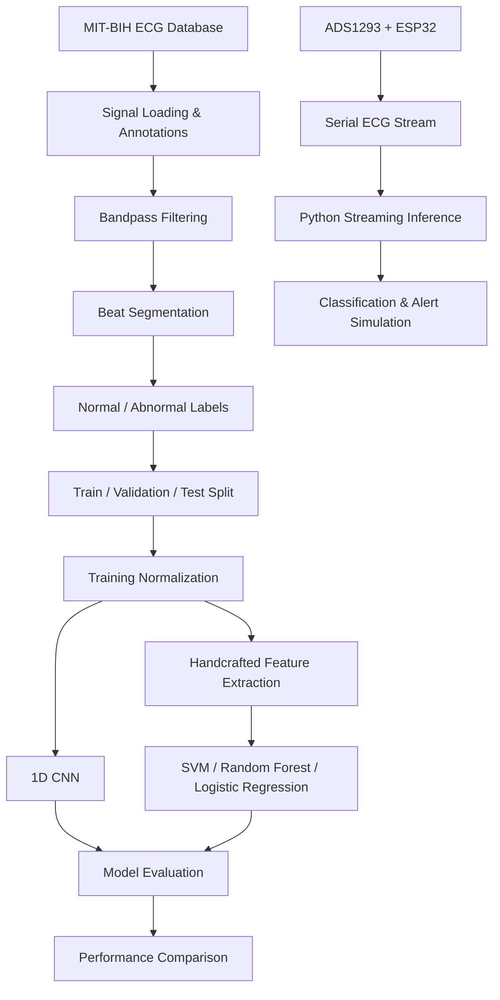

# ECG Arrhythmia Detection | Deep Learning, Classical ML & Hardware Integration


A computational ECG arrhythmia classification pipeline combining **1D Convolutional Neural Networks, classical machine learning baselines, biomedical signal processing and ESP32-based serial-stream inference**.

The project explores how deep learning and handcrafted signal features compare when classifying annotated ECG beats as normal or abnormal, using the MIT-BIH Arrhythmia Database.

---

## 1. Project Overview

Electrocardiograms (ECGs) capture the electrical activity of the heart. Detecting abnormal cardiac rhythms from ECG signals is an important problem in biomedical signal processing and machine learning.

This project implements an end-to-end experimental pipeline covering:

- ECG signal preprocessing and beat segmentation.
- Binary classification of normal and selected abnormal beat annotations.
- 1D CNN training and evaluation.
- Comparison against SVM, Random Forest and Logistic Regression.
- Model evaluation using accuracy, precision, recall, F1 and ROC-AUC.
- ESP32/ADS1293-connected streaming inference with host-side Python prediction.

**Objective:** Explore the trade-offs between automatically learned temporal features and manually engineered statistical features for ECG beat classification.

## 2. System Architecture



The training and evaluation pipeline is separate from the hardware-connected streaming inference prototype.

## 3. Dataset & Preprocessing

**Dataset:** [MIT-BIH Arrhythmia Database — PhysioNet](https://physionet.org/content/mitdb/1.0.0/)

The database contains 48 approximately half-hour, two-channel ECG recordings from 47 subjects, sampled at 360 Hz per channel.

### Signal preprocessing

The implemented preprocessing pipeline performs:

1. **Signal loading:** ECG recordings and beat annotations are loaded using WFDB.
2. **Channel selection:** The first ECG signal channel is used.
3. **Bandpass filtering:** Third-order Butterworth bandpass filter with cutoffs at 0.5–40 Hz, applied using forward-backward filtering.
4. **Beat segmentation:** A 360-sample window is extracted around each selected annotated beat, consisting of 180 samples before and 180 samples after the annotation.
5. **Binary labelling:**
   - Normal: `N`
   - Abnormal: `V`, `A`, `L`, `R`, `F`, `E`
   - Other annotation symbols are excluded.
6. **Normalization:** Global mean and standard deviation are calculated from the training beats and reused for validation and test data.

### Data partitioning

The current implementation uses a seeded, randomized **record-level split**:

| Partition | Approximate proportion |
|---|---:|
| Training | 70% |
| Validation | 15% |
| Testing | Remaining records |

Random seed: `42`

**Evaluation caveat:** The current implementation partitions recording IDs, not explicitly grouped subject IDs. Therefore, subject-independent evaluation is not guaranteed. This is especially relevant because MIT-BIH contains two recordings (201 and 202) from the same subject. The reported metrics should be treated as preliminary record-level results, not as verified subject-independent performance.

## 4. Deep Learning Model — 1D CNN

A one-dimensional convolutional neural network is implemented using TensorFlow/Keras.

### Architecture

| Layer | Configuration |
|---|---|
| Input | 360 × 1 |
| Conv Block 1 | 32 filters, kernel size 7 |
| Conv Block 2 | 64 filters, kernel size 5 |
| Conv Block 3 | 128 filters, kernel size 3 |
| Each Conv Block | Conv1D → BatchNorm → ReLU → MaxPooling |
| Global Pooling | Global Average Pooling |
| Regularization | Dropout (0.25) |
| Dense Layer | 64 neurons, ReLU |
| Output | 1 neuron, Sigmoid |

Additional training configuration:

- Optimizer: Adam
- Learning rate: 0.001
- Loss: Binary Cross-Entropy
- Optional class weighting
- Early stopping based on validation accuracy
- Model checkpointing
- Learning-rate reduction on validation-loss plateau

The network learns temporal representations directly from the segmented ECG waveform rather than relying exclusively on manually selected features.

## 5. Classical Machine Learning Baselines

To compare learned representations against handcrafted features, three classical classifiers are implemented.

### Feature extraction

Five features are extracted from each 360-sample beat:

| Feature | Description |
|---|---|
| Mean | Average signal amplitude |
| Standard deviation | Signal amplitude variation |
| Peak amplitude | Maximum absolute amplitude |
| Energy | Mean squared signal amplitude |
| RR proxy | Distance between selected peaks in the two window halves |

The final feature is a heuristic peak-distance proxy, not a clinically validated RR-interval measurement.

### Models

- Support Vector Machine (RBF kernel)
- Random Forest (300 estimators)
- Logistic Regression

The implementation also supports:

- StandardScaler preprocessing.
- Optional PCA (configured for five components).
- Optional SMOTE (disabled by default).
- Stratified subsampling for SVM training when the sample count exceeds the configured limit.

The PCA-enabled variants are included in the experimental comparison. Since the current configuration uses five input features and five PCA components, this setting should not be interpreted as a guaranteed dimensionality reduction.

## 6. Previously Reported Experimental Results

The following metrics are recorded in the repository's committed `main_pipeline/final_comparison.md`.

| Model | Accuracy | Precision | Recall | F1 |
|---|---:|---:|---:|---:|
| CNN | 99.44% | 90.91% | 100.00% | 95.24% |
| Random Forest | 97.78% | 100.00% | 60.00% | 75.00% |
| Random Forest + PCA | 97.78% | 87.50% | 70.00% | 77.78% |
| SVM | 97.78% | 80.00% | 80.00% | 80.00% |
| SVM + PCA | 97.78% | 80.00% | 80.00% | 80.00% |
| Logistic Regression | 95.56% | 55.56% | 100.00% | 71.43% |
| Logistic Regression + PCA | 95.56% | 55.56% | 100.00% | 71.43% |

These are previously recorded results, not independently reproduced results from this README update. The detailed original run logs and test-set sample counts are not currently available for verification.

### Observations

- The CNN has the highest reported accuracy and F1 score.
- Random Forest has the highest precision among the non-PCA classical baselines.
- SVM provides a more balanced precision-recall result among the classical models.
- Logistic Regression achieves high recall in the reported comparison but has lower precision.

These results illustrate a performance-versus-feature-engineering trade-off, but should be interpreted cautiously given the current record-level splitting strategy and unavailable run-level artifacts.

## 7. Hardware Integration & Streaming Inference

The project also includes an ESP32/ADS1293-connected ECG acquisition and inference prototype.

### Components

- ADS1293: ECG acquisition front end.
- ESP32: Microcontroller for ECG sample acquisition and serial transmission.
- Python: Host-side signal processing and model inference.

### Streaming workflow

1. ESP32 transmits ECG samples over serial.
2. Python receives incoming samples.
3. A rolling 360-sample window is maintained.
4. Optional bandpass filtering is applied.
5. The trained model generates an abnormality probability.
6. A configurable threshold determines the displayed classification.

Example:

```bash
python serial_infer.py --port COM5 --baud 115200 --threshold 0.5
```

Optional arguments:

- `--window`: Input window size (default 360).
- `--hop`: Prediction stride (default 180).
- `--no-filter`: Disable Python-side bandpass filtering.

**Important limitation:** Training uses annotation-centred beat windows, whereas the serial inference implementation uses rolling windows from the incoming stream. These inputs are not necessarily aligned. The streaming prototype therefore demonstrates hardware-connected inference, not a fully validated real-time beat-detection system. Model inference currently runs in the Python host application rather than directly on the ESP32.

## 8. Repository Structure

```text
ecg-anomaly-detection/
│
├── README.md
│
└── main_pipeline/
    ├── prepare_data.py
    ├── train_cnn.py
    ├── test_cnn.py
    ├── train_classical_ml.py
    ├── compare_models.py
    ├── predict_realtime.py
    ├── alert_system.py
    ├── serial_infer.py
    ├── sample_quick_test.py
    ├── run_full_pipeline_output.py
    ├── final_comparison.md
    └── requirements.txt
```

Generated datasets, trained models and run outputs are created during execution and are not represented as pre-existing downloadable artifacts in this repository structure.

## 9. Installation & Execution

### Requirements

- Python
- NumPy
- SciPy
- WFDB
- TensorFlow
- Scikit-learn
- Matplotlib
- Joblib
- PySerial

Install dependencies:

```bash
cd main_pipeline
pip install -r requirements.txt
```

Download the MIT-BIH Arrhythmia Database from [PhysioNet](https://physionet.org/content/mitdb/1.0.0/) and extract it into a directory named `mitdb` alongside the `main_pipeline` folder, or configure `DATASET_PATH` to its location.

### Run the complete pipeline

```bash
python run_full_pipeline_output.py
```

The runner executes:

```text
prepare_data.py
      ↓
train_cnn.py
      ↓
test_cnn.py
      ↓
train_classical_ml.py
      ↓
compare_models.py
```

It generates timestamped experiment logs, evaluation metrics and a model comparison report under `main_pipeline/output/`.

### Run individual stages

```bash
python prepare_data.py
python train_cnn.py
python test_cnn.py
python train_classical_ml.py
python compare_models.py
python alert_system.py
```

### Quick smoke test

```bash
python sample_quick_test.py
```

This uses synthetic data to check the pipeline components. It is not a substitute for evaluating the model on MIT-BIH.

## 10. Limitations & Future Work

The current implementation provides an experimental foundation, with several areas requiring further validation:

- Subject-independent data partitioning with explicit subject grouping.
- Reproducible experiment logs, sample counts and confusion matrices.
- More comprehensive handling of class imbalance and annotation categories.
- Clinically meaningful RR-interval and morphology-based feature extraction.
- Alignment of streaming inputs with the beat-centred training representation.
- Validation on external ECG datasets.
- Repeated runs and statistical reporting to assess performance variability.

This project is an educational and research prototype. It is not a clinically validated diagnostic or medical decision-support system.

## 11. References

1. Moody, G. B., & Mark, R. G. (2005). [MIT-BIH Arrhythmia Database](https://doi.org/10.13026/C2F305). PhysioNet.
2. Moody, G. B., & Mark, R. G. (2001). [The impact of the MIT-BIH Arrhythmia Database](https://ecg.mit.edu/george/publications/mitdb-embs-2001.pdf). IEEE Engineering in Medicine and Biology Magazine, 20(3), 45–50.

---

**Author:** Lakshya Arora  
Integrated M.Sc. Mathematics + B.E. Electrical & Electronics Engineering  
BITS Pilani, K.K. Birla Goa Campus

[GitHub](https://github.com/la9fer) · [LinkedIn](https://www.linkedin.com/in/lakshya-arora-51100329a/)
